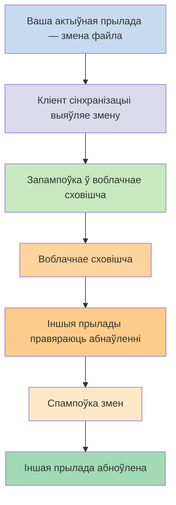
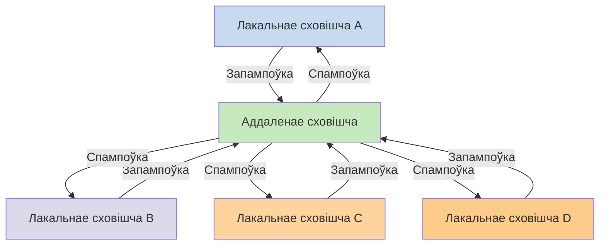

Каб карыстацца нататкамі на розных прыладах, можна [[Сінхранізацыя нататак паміж прыладамі|сінхранізаваць нататкі паміж прыладамі]]. Obsidian прапануе для гэтага ўласны сэрвіс — [[Уводзіны ў Obsidian Sync|Obsidian Sync]], які працуе інакш, чым іншыя сэрвісы сінхранізацыі, напрыклад [[Сінхранізацыя нататак паміж прыладамі#iCloud|iCloud]] і [[Сінхранізацыя нататак паміж прыладамі#OneDrive|OneDrive]].

Асноўныя тэрміны:

- **Сховішча** — папка ў файлавай сістэме, якая змяшчае нататкі і папку `.obsidian` з канфігурацыяй Obsidian.
- **Лакальнае сховішча** — копія сховішча на кожнай з вашых прылад. Пры выкарыстанні сэрвісаў сінхранізацыі вы падключаеце гэтыя лакальныя сховішчы, каб уключыць сінхранізацыю.
- **Аддаленае сховішча** — цэнтралізаванае сховішча, да якога лакальныя сховішчы падключаюцца непасрэдна праз Obsidian Sync.

Ёсць два распаўсюджаныя падыходы да сінхранізацыі:

- **[[#Файлавыя сэрвісы сінхранізацыі]]**: лакальныя сховішчы павінны знаходзіцца ў папках, за якімі сочыць сэрвіс, і сінхранізацыя адбываецца праз файлавую сістэму
- **[[#Obsidian Sync|Аддаленыя сховішчы]]**: цэнтралізаванае сховішча, да якога лакальныя сховішчы падключаюцца непасрэдна праз Obsidian

## Файлавыя сэрвісы сінхранізацыі

Сэрвісы накшталт Dropbox, Google Drive, iCloud і OneDrive працуюць з папкамі. Яны сочаць за пэўнымі папкамі і аўтаматычна сінхранізуюць усе файлы ў іх. Каб файлы сінхранізаваліся, яны павінны знаходзіцца ў адпаведных папках воблачнага сэрвісу. З такімі сэрвісамі лакальнае сховішча — проста яшчэ адна папка, за якой сочыць сэрвіс. Асобнага аддаленага сховішча няма — замест гэтага воблачнае сховішча служыць перадатчыкам, які капіюе файлы паміж лакальнымі сховішчамі на розных прыладах.

Ніжэй паказана спрошчаная схема працы такіх сэрвісаў:

Калі воблачны сэрвіс сінхранізуе ў фонавым рэжыме, некаторыя з гэтых працэсаў могуць адбывацца, нават калі вы не адкрываеце файлы ў праграмах. Такія сэрвісы сочаць за пэўнымі папкамі і аўтаматычна сінхранізуюць усе файлы ў іх. Каб файлы сінхранізаваліся, яны павінны знаходзіцца ў адпаведных папках воблачнага сэрвісу.

## Obsidian Sync

Obsidian Sync дазваляе стварыць аддаленае сховішча, якое служыць цэнтралізаваным сховішчам праз сэрвіс [[Уводзіны ў Obsidian Sync|Obsidian Sync]]. Дзякуючы гэтаму файлы можна захоўваць амаль у любой папцы на любой прыладзе — на знешнім дыску, у `C:\` або ў сховішчы праграм на Android.

Аднак калі на той жа прыладзе вы карыстаецеся і [[#Файлавыя сэрвісы сінхранізацыі|файлавымі сэрвісамі сінхранізацыі]], у нас ёсць спіс рэкамендаваных месцаў для лакальнага сховішча — галоўнае, каб гэта было месца па-за [[Пераход на Obsidian Sync#Перанос сховішча з іншага сэрвісу сінхранізацыі або воблачнага сховішча|іншым сэрвісам сінхранізацыі]].

Ніжэй паказана спрошчаная схема працы Obsidian Sync:

Перавага такой сістэмы асабліва відаць, калі тыпаў прылад шмат. [[#Файлавыя сэрвісы сінхранізацыі]] могуць па-рознаму працаваць у розных аперацыйных сістэмах, а мабільныя прылады маюць свае правілы ізаляцыі праграм і абмежавання іх энергаспажывання, што значна ўскладняе бесперабойную працу традыцыйных файлавых сэрвісаў.

У Obsidian Sync сінхранізацыя адбываецца непасрэдна праз праграму. Таму паводзіны аднолькавыя незалежна ад тыпу прылады і абмежаванняў аперацыйнай сістэмы, а лакальная копія даных заўсёды захоўваецца як [[Рэзервовае капіраванне файлаў Obsidian|мяккая рэзервовая копія]].

### Як працуе сінхранізацыя

Калі вы змяняеце файлы ў лакальным сховішчы, Obsidian Sync выяўляе змены і запампоўвае іх у аддаленае сховішча. Іншыя прылады, падключаныя да таго ж аддаленага сховішча, спампоўваюць гэтыя змены і ўжываюць іх да сваіх лакальных сховішчаў. Obsidian Sync адсочвае змены на ўзроўні файлаў і перадае толькі змененыя файлы, а не сінхранізуе цэлыя папкі. Гэта скарачае трафік і час сінхранізацыі.

Калі ўзнікаюць канфлікты або трэба кіраваць тым, якія файлы сінхранізаваць, Obsidian Sync мае для гэтага спецыяльныя механізмы:

![[Вырашэнне праблем з Obsidian Sync#Вырашэнне канфліктаў|Conflict resolution]]

![[Налады Sync і выбарачная сінхранізацыя#Выбарачная сінхранізацыя#Выключэнне папкі з сінхранізацыі]]

### Праца афлайн

Змены, зробленыя афлайн, ставяцца ў чаргу і аўтаматычна сінхранізуюцца, калі прылада зноў падключыцца да інтэрнэту і Obsidian будзе адкрыты. Пакуль вы афлайн, лакальнае сховішча цалкам працуе.

## Што далей

- [[Наладжванне Obsidian Sync|Наладзьце Obsidian Sync]], каб пачаць працаваць з аддаленымі сховішчамі.
- [[Пераход на Obsidian Sync|Перайдзіце на Obsidian Sync]], калі зараз карыстаецеся файлавай сінхранізацыяй і хочаце перайсці.
- [[Сінхранізацыя нататак паміж прыладамі|Разгледзьце іншыя спосабы сінхранізацыі]], калі яшчэ не вырашылі.
