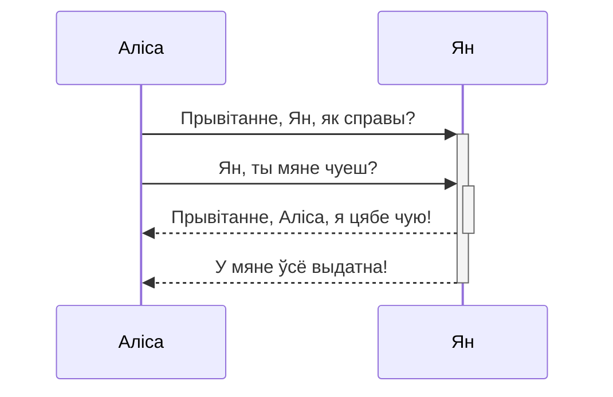
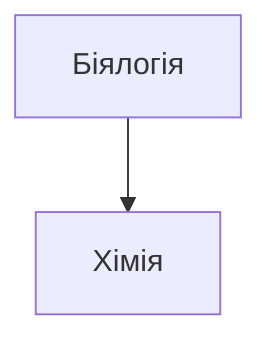

Даведайцеся, як дадаваць у нататкі больш складанае фарматаванне.

## Табліцы

Табліцы ствараюцца з дапамогай вертыкальных рыс (`|`), якія раздзяляюць слупкі, і злучкоў (`-`), якія вызначаюць загалоўкі. Напрыклад:

```md
| Імя        | Прозвішча |
| ---------- | --------- |
| Макс       | Планк     |
| Марыя      | Кюры      |
```

| Імя        | Прозвішча |
| ---------- | --------- |
| Макс       | Планк     |
| Марыя      | Кюры      |

Вертыкальныя рысы па краях табліцы неабавязковыя, але раім іх ставіць, каб табліцу было лягчэй чытаць.

> [!tip] У _Дынамічным праглядзе_ можна пстрыкнуць па табліцы правай кнопкай мышы, каб дадаць або выдаліць слупкі і радкі. Праз кантэкстнае меню іх таксама можна сартаваць і перамяшчаць.

Табліцу можна ўставіць камандай **Уставіць табліцу** з [[Меню каманд|меню каманд]] або пстрыкнуўшы правай кнопкай мышы і выбраўшы _Уставіць → Табліца_. Атрымаецца простая табліца для рэдагавання:

```md
|     |     |
| --- | --- |
|     |     |
```

Ячэйкі не абавязкова ідэальна выраўноўваць, але радок загалоўка павінен змяшчаць хаця б два злучкі:

```md
Імя | Прозвішча
-- | --
Макс | Планк
Марыя | Кюры
```


### Фарматаванне змесціва табліцы

Для афармлення змесціва табліцы можна выкарыстоўваць [[Асноўны сінтаксіс фарматавання|асноўны сінтаксіс фарматавання]].

| Першы слупок                              | Другі слупок                             |
| ----------------------------------------- | ---------------------------------------- |
| [[Унутраныя спасылкі\|Унутраныя спасылкі]]    | Спасылка на файл _унутры_ **сховішча**.  |
| [[Убудаванне файлаў\|Убудаванне файлаў]]        | ![[Engelbart.jpg\|100]]                  |

> [!note] Вертыкальныя рысы ў табліцах
> Калі ў табліцы трэба выкарыстаць [[Псеўданімы|псеўданімы]] або [[Асноўны сінтаксіс фарматавання#Знешнія відарысы|змяніць памер відарыса]], пастаўце перад вертыкальнай рысай `\`.
>
> ```md
> Першы слупок | Другі слупок
> -- | --
> [[Асноўны сінтаксіс фарматавання\|Сінтаксіс Markdown]] | ![[Engelbart.jpg\|200]]
> ```
>
> Першы слупок | Другі слупок
> -- | --
> [[Асноўны сінтаксіс фарматавання\|Сінтаксіс Markdown]] | ![[Engelbart.jpg\|200]]

Каб выраўнаваць тэкст у слупках, дадайце ў радок загалоўка двукроп'і (`:`). У _Дынамічным праглядзе_ змесціва можна выраўноўваць і праз кантэкстнае меню.

```md
Тэкст па левым краі | Тэкст па цэнтры | Тэкст па правым краі
:-- | :--: | --:
Змесціва | Змесціва | Змесціва
```

Тэкст па левым краі | Тэкст па цэнтры | Тэкст па правым краі
:-- | :--: | --:
Змесціва | Змесціва | Змесціва

## Дыяграмы

У нататкі можна дадаваць дыяграмы і схемы з дапамогай [Mermaid](https://mermaid-js.github.io/). Mermaid падтрымлівае мноства дыяграм, напрыклад [блок-схемы](https://mermaid.js.org/syntax/flowchart.html), [дыяграмы паслядоўнасці](https://mermaid.js.org/syntax/sequenceDiagram.html) і [часавыя шкалы](https://mermaid.js.org/syntax/timeline.html).

> [!tip] Парада
> Каб падрыхтаваць дыяграму перад тым, як дадаць яе ў нататку, паспрабуйце [Live Editor](https://mermaid-js.github.io/mermaid-live-editor) ад Mermaid.

Каб дадаць дыяграму Mermaid, стварыце [[Асноўны сінтаксіс фарматавання#Блокі кода|блок кода]] `mermaid`.

````md

````


````md

````


### Спасылкі на файлы ў дыяграме

Каб стварыць [[Унутраныя спасылкі|унутраныя спасылкі]] у дыяграме, прызначце вузлам [клас](https://mermaid.js.org/syntax/flowchart.html#classes) `internal-link`.

````md

````


> [!note] Заўвага
> Унутраныя спасылкі з дыяграм не паказваюцца ў [[Граф|графе]].

Калі ў дыяграме шмат вузлоў, можна скарыстацца наступным фрагментам.

````md

````

Так кожны вузел-літара становіцца ўнутранай спасылкай, а [тэкст вузла](https://mermaid.js.org/syntax/flowchart.html#a-node-with-text) — тэкстам спасылкі.

> [!note] Заўвага
> Калі ў назвах нататак ёсць спецыяльныя сімвалы, назву трэба ўзяць у двукоссе.
>
> ```
> class "⨳ спецыяльны сімвал" internal-link
> ```
>
> Або `A["⨳ спецыяльны сімвал"]`.

Падрабязней пра стварэнне дыяграм — у [афіцыйнай дакументацыі Mermaid](https://mermaid.js.org/intro/).

## Матэматыка

У нататкі можна дадаваць матэматычныя выразы з дапамогай [MathJax](http://docs.mathjax.org/en/latest/basic/mathjax.html) і нотацыі LaTeX.

Каб дадаць выраз MathJax, вазьміце яго ў падвойныя знакі даляра (`$$`).

```md
$$
\begin{vmatrix}a & b\\
c & d
\end{vmatrix}=ad-bc
$$
```

$$
\begin{vmatrix}a & b\\
c & d
\end{vmatrix}=ad-bc
$$

Матэматычныя выразы можна ўстаўляць і ў радок, узяўшы іх у знакі `$`.

```md
Гэта ўбудаваны матэматычны выраз $e^{2i\pi} = 1$.
```

Гэта ўбудаваны матэматычны выраз $e^{2i\pi} = 1$.

Падрабязней пра сінтаксіс — у [MathJax basic tutorial and quick reference](https://math.meta.stackexchange.com/questions/5020/mathjax-basic-tutorial-and-quick-reference).

Спіс падтрымліваемых пакетаў MathJax — у [The TeX/LaTeX Extension List](http://docs.mathjax.org/en/latest/input/tex/extensions/index.html).
