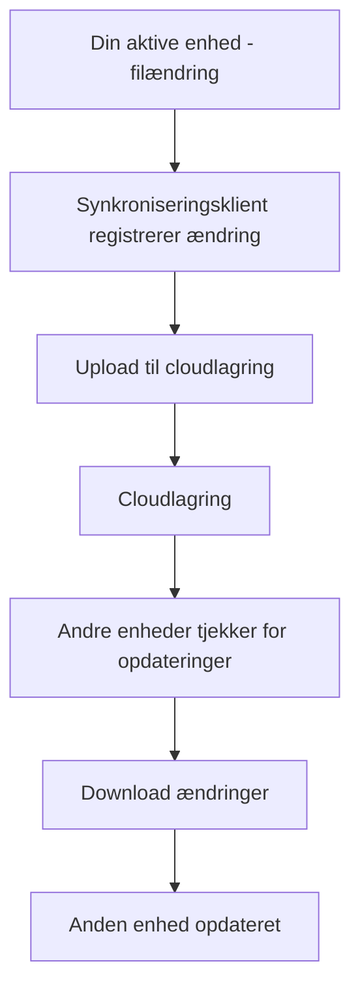
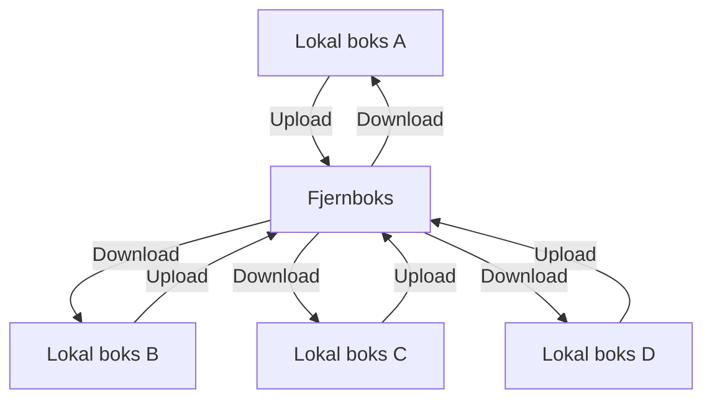

Hvis du vil bruge dine noter på forskellige enheder, er en af mulighederne at [[Synkroniser dine noter på tværs af enheder|synkronisere dine noter på tværs af enheder]]. Obsidian tilbyder en sådan tjeneste, [[Introduktion til Obsidian Sync|Obsidian Sync]], der fungerer anderledes end andre synkroniseringstjenester som [[Synkroniser dine noter på tværs af enheder#iCloud|iCloud]] og [[Synkroniser dine noter på tværs af enheder#OneDrive|OneDrive]].

Her er nogle vigtige begreber:

- En **boks** er en mappe i dit filsystem, som indeholder noter og en `.obsidian`-mappe med Obsidian-specifik konfiguration.
- En **lokal boks** er kopien af din boks, der findes på hver af dine enheder. Når du bruger synkroniseringstjenester, forbinder du disse lokale bokse for at aktivere synkronisering.
- En **fjernboks** er centraliseret lagring, som lokale bokse forbinder til direkte gennem Obsidian Sync.

Der er to almindelige tilgange til synkronisering:

- **[[#Filbaserede synkroniseringstjenester]]**: Lokale bokse skal være i overvågede mapper; synkronisering sker gennem filsystemet
- **[[#Obsidian Sync|Fjernbokse]]**: Centraliseret lagring, som lokale bokse forbinder til direkte gennem Obsidian

## Filbaserede synkroniseringstjenester

Tjenester som Dropbox, Google Drive, iCloud og OneDrive er mappebaserede. Disse tjenester overvåger bestemte mapper og synkroniserer automatisk alle filer, der placeres i dem. Filer skal være i de udpegede cloudtjeneste-mapper for at blive synkroniseret. Med filbaserede synkroniseringstjenester fungerer din lokale boks blot som endnu en overvåget mappe. Der er ingen dedikeret fjernboks – i stedet fungerer cloudlagringen som et mellemled, der kopierer filer mellem lokale bokse på forskellige enheder.

Diagrammet nedenfor viser en forenklet version af, hvordan disse tjenester fungerer:

Hvis cloudtjenesten har baggrundssynkronisering, kan nogle af disse processer finde sted, selv når du ikke aktivt bruger applikationerne til at se filerne. Disse tjenester overvåger bestemte mapper og synkroniserer automatisk alle filer, der placeres i dem. Filer skal være i de udpegede cloudtjeneste-mapper for at blive synkroniseret.

## Obsidian Sync

Obsidian Sync giver dig mulighed for at oprette en fjernboks, der fungerer som centraliseret lagring gennem tjenesten [[Introduktion til Obsidian Sync|Obsidian Sync]]. Dette giver dig mulighed for at vælge næsten enhver mappe på enhver af dine enheder til at gemme dine filer – uanset om det er på en ekstern harddisk, i `C:\` eller i App-lagring på Android.

Vi har dog en liste over anbefalede placeringer til din lokale boks, hvis du også bruger [[#Filbaserede synkroniseringstjenester]] på den samme enhed – primært et sted, der ikke er i en [[Skift til Obsidian Sync#Move your vault out of your third-party syncing service or cloud storage|tredjepartssynkroniseringstjeneste]].

Diagrammet nedenfor viser en forenklet version af, hvordan Obsidian Sync fungerer:

Styrken ved dette system bliver mere tydelig med flere enhedstyper. [[#Filbaserede synkroniseringstjenester]] kan være implementeret inkonsistent på tværs af operativsystemer, og mobile enheder har deres egne regler for, hvordan applikationer kan sandboxes og strømstyres, hvilket gør det meget sværere for traditionelle filbaserede tjenester at fungere problemfrit.

Med Obsidian Sync håndterer tjenesten synkronisering direkte gennem applikationen, hvilket giver ensartet adfærd uanset enhedstype eller operativsystembegrænsninger, samtidig med at den prioriterer at bevare en lokal kopi af dine data som en [[Sikkerhedskopiér dine Obsidian-filer|blød sikkerhedskopi]].

### Synkroniseringsadfærd

Når du foretager ændringer i filer i din lokale boks, registrerer Obsidian Sync disse ændringer og uploader dem til fjernboksen. Andre enheder, der er forbundet til den samme fjernboks, downloader derefter disse ændringer og anvender dem på deres lokale bokse. Obsidian Sync sporer ændringer på filniveau og overfører kun de filer, der er blevet ændret, i stedet for at synkronisere hele mapper. Dette reducerer båndbreddeforbrug og synkroniseringstid.

Når der opstår konflikter, eller når du har brug for at styre, hvilke filer der synkroniseres, tilbyder Obsidian Sync specifikke mekanismer til at håndtere disse situationer:

![[Fejlfinding af Obsidian Sync#Conflict resolution|Konfliktløsning]]

![[Sync indstillinger og selektiv synkronisering#Selective syncing#Exclude a folder from syncing]]

### Offlineadfærd

Ændringer foretaget offline sættes i kø og synkroniseres automatisk, når din enhed genopretter forbindelsen til internettet, og Obsidian er åben. Din lokale boks forbliver fuldt funktionel i offlineperioder.

## Næste skridt

- [[Opsæt Obsidian Sync]] for at komme i gang med fjernbokse.
- [[Skift til Obsidian Sync]] hvis du i øjeblikket bruger filbaseret synkronisering og vil bruge Obsidian Sync.
- [[Synkroniser dine noter på tværs af enheder|Udforsk andre synkroniseringsmuligheder]] hvis du stadig overvejer.
